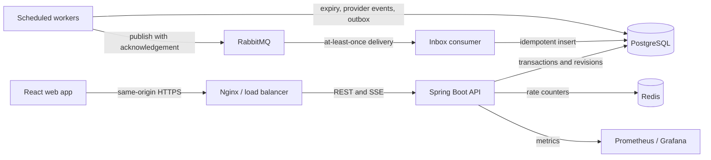
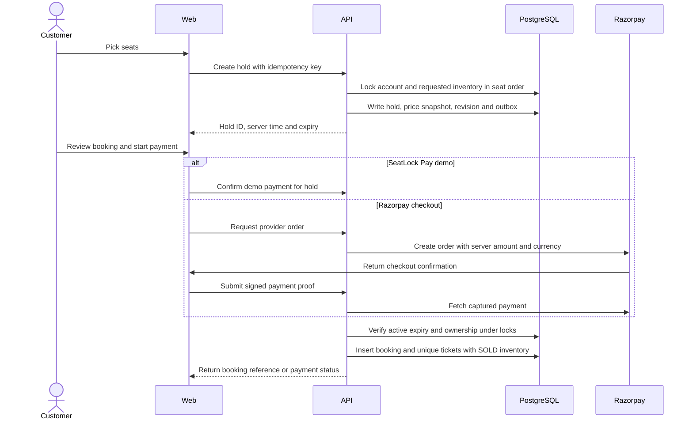
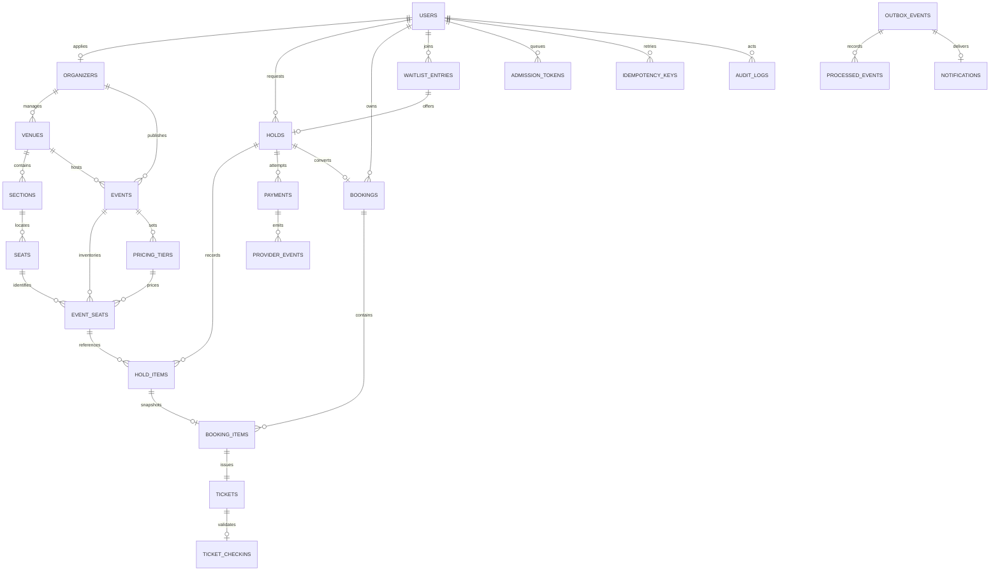

# Architecture and reservation invariants

## Booking sequence

## Data model

## Concurrency decisions

- Each hold, provider fulfillment, expiration, inventory block and refund is a short transaction. Existing holds are locked before their seats. A customer lock serializes the account cap across disjoint requests. Seat locks are taken by ascending seat ID.
- A new hold can reclaim an expired seat without locking its former hold. A cleanup worker releases only rows still owned by the old hold and may mark the old hold expired even if it no longer owns any rows.
- The confirmation transaction reads the database clock after taking the locks. SeatLock Pay commits its demo payment and booking together. A Razorpay capture past expiry or without all the seats queues an idempotent refund. A processed refund voids tickets in the same transaction that restores inventory. Check-in and refund serialize on ticket rows.
- Payment events, idempotency scopes, hold-to-booking identity, check-ins and active ticket ownership have database uniqueness constraints. Idempotency replay returns the existing resource with its current status.
- Each inventory change increments the event revision before commit. The SSE channel sends event ID and revision. Every update and reconnect triggers a full snapshot. Fallback polling handles network loss and lazy-expiry changes.
- Waiting room admission is a two-minute lease tied to the authenticated account and event. Joining again while queued keeps the same position. Rejoining after expiry goes to the back. Waitlists reserve available inventory for the oldest eligible group, give preference to wheelchair inventory only when requested, and do not promise adjacent seats. A group at the head can delay smaller groups.
- Outbox claims use `SKIP LOCKED`. A publisher acknowledgement and a separate database commit can produce redelivery after process loss. The notification transaction inserts its consumer key and derived notification together. The broker is outside the seat mutation transaction.

[PostgreSQL 16 row lock documentation](https://www.postgresql.org/docs/16/explicit-locking.html)
